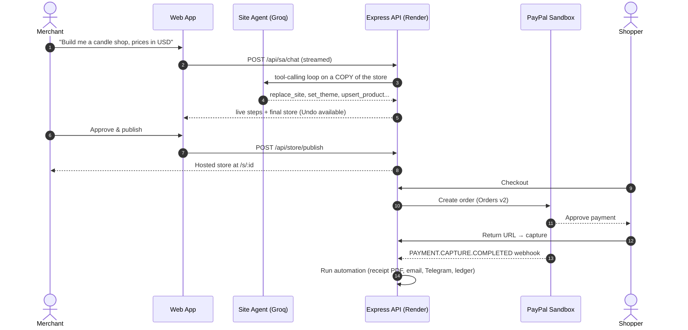
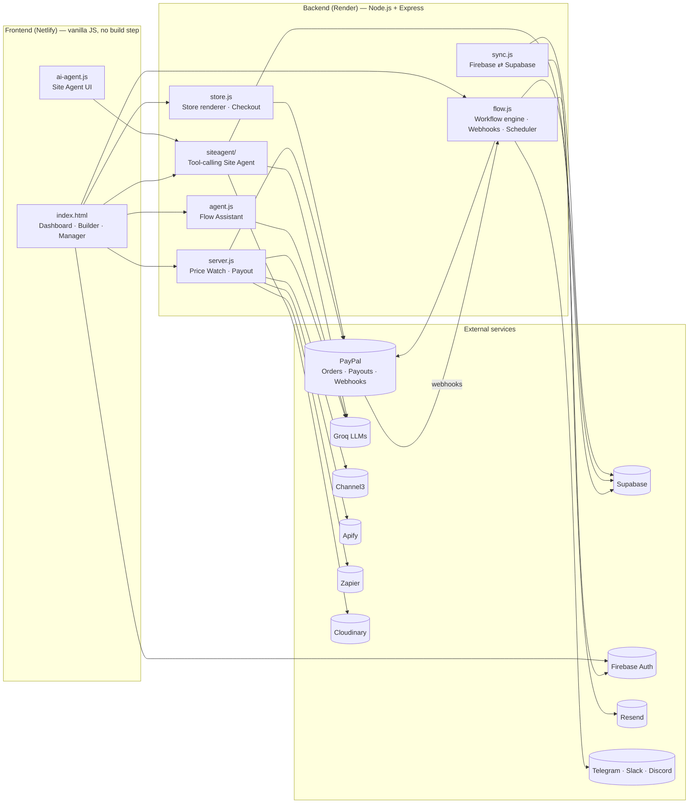

<div align="left">

#  PayPal AI

### Describe your business. Let AI build the store, the automations and the cashback — all on PayPal.

An AI-native commerce studio built on the **PayPal Developer Platform**: generate a hosted PayPal-checkout web store from a chat, wire up post-purchase automations with a visual workflow builder, and pay shoppers price-drop cashback through PayPal Payouts.

[](https://paypalaihackathon.devpost.com/)
[](LICENSE)
[](https://nodejs.org/)
[](https://render.com/)


[**Live Demo**](https://your-frontend-url.netlify.app) · [**Demo Video**](https://youtube.com/your-video-link) · [**Devpost Submission**](https://devpost.com/software/your-project) · [**Report a Bug**](../../issues)

</div>

> **Note for judges:** everything runs against the **PayPal Sandbox**. No real money moves. The backend hard-codes `https://api-m.sandbox.paypal.com`, so live credentials can never be used by mistake.

---

## 📑 Table of Contents

1. [Overview](#-overview)
2. [The Problem](#-the-problem)
3. [Features](#-features)
4. [How It Works](#-how-it-works)
5. [Architecture](#-architecture)
6. [Tech Stack & Integrations](#-tech-stack--integrations)
7. [Hackathon Alignment](#-hackathon-alignment)
8. [Getting Started](#-getting-started)
9. [Environment Variables](#-environment-variables)
10. [Deployment](#-deployment)
11. [API Reference](#-api-reference)
12. [Security](#-security)
13. [Project Structure](#-project-structure)
14. [Roadmap](#-roadmap)
15. [Contributing](#-contributing)
16. [License](#-license)
17. [Acknowledgements](#-acknowledgements)

---

## 🧭 Overview

**PayPal AI** is a single web app with four connected products that cover the full life of a small online business:

| # | Module | What it does |
|---|--------|--------------|
| 1 | **Web Store Builder + Site Agent** | Chat with an AI agent to generate, edit and publish a real store with PayPal checkout. |
| 2 | **Workflow Builder + Flow Assistant** | Drag-and-drop automations that fire on PayPal events, with an AI assistant that builds the flow for you. |
| 3 | **Store Manager** | A ledger and activity view of money in and out (B2B, B2C, C2B, G2C) fed by your automations.

It was built for the **[PayPal AI Hackathon 2026 — "Build What's Next with PayPal and AI"](https://paypalaihackathon.devpost.com/)**, where the one hard requirement is that a project **meaningfully uses both PayPal and AI**. Here, PayPal is not a bolt-on: it is the payment rail, the event source, the payout engine and the data the AI reasons over.

---

## 🎯 The Problem

Small merchants and solo founders lose time on three things that PayPal alone does not automate:

- **Getting online.** Building a store, writing copy, hosting it and wiring checkout takes days.
- **Reacting to payments.** Receipts, refunds, fraud checks, team alerts and bookkeeping are manual copy-paste work across five tools.
- **Rewarding shoppers.** Price-drop and cashback programmes need product data, price tracking and a way to actually pay people.

## ✅ Our Solution

PayPal AI puts an **agent in front of PayPal**. You describe what you want in plain language; the agent edits a *private copy* of your store or workflow through **validated tools**, shows you every step it took, and asks for your **explicit approval** before anything is published or any money moves.

---

## ✨ Features

### 1. 🛍️ Web Store Builder & Site Agent ("Build with AI")

- **One-prompt store generation.** Describe a business and the agent writes the whole site: brand, tagline, announcement bar, hero, 3–4 feature highlights, 6–8 products, About, FAQs and footer.
- **Conversational editing.** "Make it darker", "add a candle for $18", "switch to euros", "turn on the wishlist". The agent calls typed tools such as `set_theme`, `upsert_product`, `set_commerce` and `set_plugins`.
- **Transparent agent.** The chat streams the agent's one-line plan, each tool call with its inputs, and what each call changed. Every turn is applied with **one-click Undo**.
- **Hosted storefronts.** Each published store is served from `/s/:id` with server-side rendered, escaped HTML.
- **Real PayPal checkout.** Orders are created and captured through **PayPal Orders v2** entirely in the backend, with a return URL flow back to the store.
- **Per-store payment gateway.** A merchant can connect their own sandbox app. Credentials are encrypted at rest (AES-256-GCM).
- **Store plugins** you can toggle by chat: sidebar menu, wishlist, app-style navigator, PayPal buttons, Pay Later, card button and QR code.
- **Photo upload with Cloudinary.** Merchants upload up to 4 product photos at a time; images are optimised automatically (see [Cloudinary](#-cloudinary--product-image-storage-and-delivery)).
- **Safe by design.** Every tool result passes through `sanitizeSpec()`, so the output is always a valid, escaped, renderable store. The agent cannot publish by itself (it can only *request* approval).

### 2. 🔀 Workflow Builder & Flow Assistant

- **35 node types** across triggers, AI, logic and actions.
- **Triggers:** Web Store Order, Payment Received, Refund Issued, Dispute Opened, Subscription Paid, Scheduled (cron).
- **AI nodes:** Risk Score, Fraud Detection, Document Verification, Customer Segmentation, Data Extraction, AI Email Draft.
- **Logic:** Condition (Yes/No branches) and Delay.
- **PayPal API actions:** Capture Payment, Issue Refund, Fetch Balance, Get Order Details, Get Capture Details, Create Order, Transaction Search, Dispute Details.
- **Notification actions:** Telegram, Slack, Discord and Email.
- **Documents:** Receipt Generator (server-built **PDF invoice**), Telegram: Send Receipt, Email Receipt.
- **Bookkeeping:** Database Log, Record in Store Manager, Update Customer, Manual Review, Flag Transaction, Set Field (reusable `{{variables}}`).
- **Flow Assistant.** A tool-calling agent that builds and edits your workflow from a sentence. It **never moves money** (test runs are dry runs) and **never sees pasted bot tokens**: Telegram tokens are verified and sealed on the server *before* the model is called.
- **Durable automations.** Workflows and receipts are saved to Supabase and restored on server start, so a Render restart never silently deletes your automation.

### 3. 🏷️ Price Watch & Cashback Payouts

- **Paste any product URL** (Amazon, Flipkart or any store). Product title, price and currency are resolved through a resilient lookup chain (see [Channel3](#-channel3--product-intelligence) and Apify).
- **AI-chosen target.** Groq picks a realistic price-drop threshold of 5–30% with a one-line reason, falling back to 10% if AI is unavailable.
- **Continuous checking** through `/api/check`, with a short server cache so repeated checks do not burn scraper credits.
- **Automatic cashback.** When the price hits the target, the app computes the affiliate commission and sends **50% of it to the shopper via PayPal Payouts**, then notifies a Zapier webhook.
- INR prices are converted to USD (`INR_PER_USD`, default 84) before payout.

### 4. 📒 Store Manager

A ledger and activity view of your business. Workflow runs write their payments here as money in or out, tagged **B2B / B2C / C2B / G2C**. Test runs never write to your books.

### 5. 🔔 Production-minded extras

- PayPal **webhook signature verification** for incoming events.
- **Rate limiting** on sensitive endpoints (connect, upload, email tests, Telegram).
- **Secret scrubbing** (API keys and bot tokens are redacted from chat before they reach any model or log).
- **Model fallback chain and key rotation** for AI calls, so a rate limit on one model does not break the app.
- **Full audit trail** of every Site Agent turn (request, tool calls, store before/after hashes, generated artifact).

---

## ⚙️ How It Works



---

## 🏗️ Architecture



**Design principles**

1. **Agents edit copies, humans approve.** AI tools operate on a private copy of the spec; publishing and payouts need an explicit tap.
2. **Validate everything.** Every agent output is re-validated against the same sanitizer the renderer uses.
3. **Degrade gracefully.** Without a database key, storage falls back to local files. Without Groq, Price Watch falls back to a 10% target. Without Channel3, the lookup falls back to scraping and then Apify.
4. **Sandbox only.** PayPal base URL is fixed to the sandbox.

---

## 🧰 Tech Stack & Integrations

| Layer | Technology |
|-------|-----------|
| Frontend | Vanilla JavaScript, HTML/CSS (single-file app, no build step), hosted on **Netlify** |
| Backend | **Node.js ≥ 18**, **Express 4**, ES Modules |
| Payments | **PayPal** Orders v2, Payouts, Webhooks, Transaction Search (Sandbox) |
| AI | **Groq** (`openai/gpt-oss-120b` default, with `gpt-oss-20b`, `qwen3` and `llama-3.3-70b` fallbacks) |
| Product data | **Channel3**, direct page parsing, **Apify** actors |
| Hosting | **Render** (API), **Netlify** (UI) |
| Automation | **Zapier** webhook, Slack, Discord, Telegram Bot API |
| Email | **Resend** |
| Images | **Cloudinary** |
| Database | **Supabase** (PostgREST) |
| Auth | **Firebase Authentication** |

### 🅿️ PayPal — the core of the product

PayPal is the payment rail *and* the event source for the whole app.

| PayPal capability | Where we use it |
|---|---|
| **Orders v2** (create + capture) | Customer checkout on every published store, and the *Create Order* / *Capture Payment* workflow nodes. |
| **Payouts API** | Sends price-drop cashback to the shopper's PayPal email. |
| **Webhooks** (`PAYMENT.CAPTURE.COMPLETED`, refunds, disputes, subscriptions) | Trigger user-built automations. Signatures are verified with PayPal's `verify-webhook-signature`. |
| **Refunds** | *Issue Refund* workflow node. |
| **Disputes** | *Dispute Opened* trigger and *Dispute Details* node. |
| **Transaction Search & Balances** | *Fetch Balance* and *Transaction Search* nodes. |
| **Bring-your-own sandbox app** | Merchants connect their own client ID/secret from the UI. Secrets are held in memory (flows) or encrypted at rest (stores) and are never returned to the browser. |

### 🤖 Groq — the AI engine

Groq's low-latency inference makes tool-calling agents feel instant. We use it in three places:

- **Site Agent:** builds and edits stores through ~17 typed tools in a loop of up to 14 steps.
- **Flow Assistant:** builds workflows through validated tools, up to 30 steps.
- **Price Watch:** chooses a realistic discount threshold and explains why.

The loop rotates across models and API keys, handles rate limits (429), oversized requests and network errors, and waits and retries once if everything is cooling down. Reasoning effort is configurable (`low`, `medium`, `high`).

### 🛒 Channel3 — product intelligence

Channel3 resolves **any product URL** into title, price, currency and the maximum affiliate commission rate. That commission rate is what funds the shopper's cashback. If Channel3 cannot read a page, the backend tries a JSON-LD / Open Graph scrape of the product page and finally an **Apify** actor (Amazon, Flipkart or generic e-commerce). Results are cached for a few minutes so repeat checks stay cheap.

### 🚀 Render — backend hosting

The Express API is deployed as a **Render Web Service** (`https://paypal-ai-backend.onrender.com`). Render gives us:

- Zero-config Node deploys from GitHub with HTTPS out of the box.
- A stable public URL, which PayPal needs to deliver **webhooks** to `/webhooks/paypal`.
- Environment-variable management for every secret in this project.
- Because Render restarts services, all automations and receipts are **persisted to Supabase and rehydrated on boot**.

> On Render's free tier a service sleeps when idle. Scheduled workflows only run while the server is awake, so use a paid instance (or an uptime pinger) for production schedules.

### ⚡ Zapier — outbound automation

After every successful cashback payout the backend POSTs a JSON payload (`email`, `product`, `price`, `currency`, `payout`) to a **Zapier webhook** (`ZAPIER_WEBHOOK_URL`). From there a merchant can add rows to Google Sheets, post to a CRM, send a Slack message or trigger any of Zapier's 7,000+ app integrations, with no code. The call is fire-and-forget, so a Zapier outage never blocks a payout.

### 🖼️ Cloudinary — product image storage and delivery

Merchants upload product photos from the Site Agent chat. We use Cloudinary so that **secrets never touch the browser** and published stores load fast:

- **Signed server-side uploads.** The browser sends the image to `/api/sa/upload`; the server signs the request (SHA-1) with the API secret and uploads to Cloudinary. Only the resulting URL is returned.
- **Organised storage** in the `paypal-ai/site-agent` folder.
- **Automatic optimisation.** Returned URLs are rewritten with `f_auto,q_auto,w_1000`, so Cloudinary serves the best format (WebP/AVIF where supported), automatic quality and a 1000px maximum width.
- **Guard rails.** Max 4 images per request, JPEG/PNG/WebP/GIF only, size-capped, rate-limited to 30 requests per minute.
- **Flexible config.** Use `CLOUDINARY_URL` or the three individual variables.

### 🗄️ Supabase — durable storage

Supabase (via its REST API with a server-only service-role key) stores:

| Table | Purpose |
|---|---|
| `ppai_flow_workflows` | Saved automations (restored on restart). |
| `ppai_receipts` | Generated PDF receipts, so old receipt links keep working. |
| `ppai_published_stores` | Published store specs. |
| `ppai_ai_chat_runs` | Audit log of each Site Agent turn. |

If no key is set, every database helper is a safe no-op and the app keeps working from local files.

### 🔐 Firebase Authentication

Users sign in with Firebase Auth in the browser. `POST /api/auth/claim` verifies the Firebase ID token and adds the custom claim `role: "authenticated"`, which lets **Supabase Third-Party Auth** accept the same token. A one-off script, `backfill-users.mjs`, migrates existing users.

### ✉️ Resend, Telegram, Slack & Discord — notifications

- **Resend** delivers transactional email, including the PDF receipt.
- **Telegram** bots send alerts and receipts (tokens are verified with `getMe` and encrypted at rest).
- **Slack** and **Discord** use incoming webhooks.

---

## 🏆 Hackathon Alignment

| Judging criterion | How PayPal AI delivers |
|---|---|
| **Technological Implementation** | Orders v2, Payouts, Webhooks (with signature verification), Refunds, Disputes and Transaction Search; multi-model tool-calling agents with fallback and key rotation; encrypted credentials; durable persistence; PDF receipts; cron scheduler. |
| **Design** | One coherent dashboard across store building, automation, payouts and bookkeeping; stores themed by AI with live preview, undo and step-by-step transparency. |
| **Potential Impact** | Lets non-technical merchants launch a PayPal-powered store and automate fulfilment, fraud checks and bookkeeping in minutes. Cashback gives shoppers a reason to come back. |
| **Innovation / Idea** | *Agents that act on PayPal safely:* they edit copies, explain every step, and need human approval to publish or pay. Price-drop cashback funded by affiliate commission is a new loop. |
| **Presentation** | Public repo, hosted demo, setup instructions, and a demo video under 3 minutes. |

**Special awards this project targets:** Best Use of PayPal + AI · Best Use of Agentic Commerce · Best Use of Channel3 · Best Use of Render · Most Impactful.

**Sponsor tools used:** Channel3 (product lookup + commission data), Render (hosting), Zapier (post-payout automation).

---

## 🚀 Getting Started

### Prerequisites

- **Node.js 18 or newer** and npm
- A free **[PayPal Developer](https://developer.paypal.com/)** account with a **Sandbox REST app** (client ID and secret)
- A **[Groq](https://console.groq.com/)** API key (free tier works)
- Optional: Channel3, Apify, Zapier, Cloudinary, Supabase, Firebase, Resend and Telegram credentials (each feature degrades gracefully without them)

### 1. Clone

```bash
git clone https://github.com/<your-username>/paypal-ai.git
cd paypal-ai
```

### 2. Configure the backend

```bash
cd backend
cp .env.example .env
# open .env and fill in at least PAYPAL_CLIENT_ID, PAYPAL_CLIENT_SECRET and GROQ_API_KEY
npm install
```

### 3. Run the backend

```bash
npm start
# → listening on http://localhost:3000   (or the PORT you set)
curl http://localhost:3000/api/health
```

### 4. Run the frontend

The frontend is a static, build-free app (`index.html` + `ai-agent.js`). Serve the repository root with any static server:

```bash
# from the repo root
npx serve .
```

Then point the frontend at your backend: search `index.html` for `paypal-ai-backend.onrender.com` and replace it with `http://localhost:3000` for local development.

### 5. Try it

1. Sign in, open **Build with AI**, and type: *"A small-batch candle shop with 6 products, prices in USD."*
2. Review the agent's steps, then **Approve & publish**.
3. Open the store link, add a candle to the cart and pay with a **PayPal sandbox buyer** account.
4. Open **Workflow Builder** and ask the Flow Assistant: *"When a store order comes in, make a PDF receipt, email it to the buyer and log it."*
5. Open **Price Watch**, paste a product URL and watch the AI pick the cashback target.

### Webhook testing (local)

PayPal needs a public URL to deliver webhooks. Expose your local server with a tunnel (for example `ngrok http 3000`), then in **developer.paypal.com → your sandbox app → Webhooks** add `https://<tunnel>/webhooks/paypal` and copy the **Webhook ID** into `PAYPAL_WEBHOOK_ID`.

---

## 🔧 Environment Variables

Copy `backend/.env.example` to `backend/.env`. Never commit real secrets.

| Variable | Required | Purpose |
|---|:---:|---|
| `PORT` | | Server port (default `3000`). |
| `ALLOWED_ORIGIN` | ✅ | Frontend origin allowed by CORS (e.g. `https://your-app.netlify.app`). |
| `PUBLIC_API_URL` | ✅ | Public backend URL, used for return URLs and webhooks. |
| `PAYPAL_CLIENT_ID` / `PAYPAL_CLIENT_SECRET` | ✅ | PayPal **Sandbox** app credentials. |
| `PAYPAL_WEBHOOK_ID` | ✅ | Webhook ID for signature verification. |
| `GROQ_API_KEY` | ✅ | AI features. `GROQ_API_KEYS` accepts a comma-separated list for rotation. |
| `GROQ_MODEL`, `AGENT_MODEL`, `SITE_AGENT_MODEL` | | Override default models. |
| `CHANNEL3_API_KEY` | | Product lookup and commission data. |
| `APIFY_API_TOKEN` | | Fallback scraper for Amazon, Flipkart and other stores. |
| `ZAPIER_WEBHOOK_URL` | | Fires after each cashback payout. |
| `CLOUDINARY_URL` *or* `CLOUDINARY_CLOUD_NAME` + `CLOUDINARY_API_KEY` + `CLOUDINARY_API_SECRET` | | Product photo uploads. |
| `SUPABASE_URL`, `SUPABASE_SERVICE_ROLE_KEY` | | Durable storage (server-side only). |
| `FIREBASE_SERVICE_ACCOUNT` | | Service-account JSON (raw or base64) for `/api/auth/claim`. |
| `RESEND_API_KEY`, `EMAIL_FROM` | | Email and PDF receipts. |
| `TELEGRAM_BOT_TOKEN` | | Default Telegram alerts bot. |
| `SLACK_WEBHOOK_URL`, `DISCORD_WEBHOOK_URL` | | Chat alerts. |
| `STORE_SECRET` | ✅ (prod) | Passphrase used to encrypt per-store gateway credentials. |
| `INR_PER_USD` | | INR → USD rate for payouts (default `84`). |

---

## ☁️ Deployment

### Backend on Render

1. Push this repository to GitHub.
2. In Render, create a **New → Web Service** and connect the repo.
3. Set **Root Directory** to `backend`, **Build Command** to `npm install`, **Start Command** to `npm start`.
4. Add the environment variables from the table above.
5. Copy the Render URL into `PUBLIC_API_URL`, and register `https://<render-url>/webhooks/paypal` in your PayPal sandbox app.
6. Verify with `GET /api/health`.

### Frontend on Netlify

1. Create a new Netlify site from the same repo with **no build command** and the repo root as the publish directory.
2. Update the API base URL in `index.html` to your Render URL.
3. Set `ALLOWED_ORIGIN` on Render to your Netlify domain.

---

## 📡 API Reference

All routes are served by the Express backend. A few are also available without the `/api` prefix for legacy compatibility.

<details>
<summary><strong>Price Watch & Payouts</strong></summary>

| Method | Route | Description |
|---|---|---|
| `POST` | `/api/watch` | Resolve a product URL and return an AI-suggested target price. |
| `POST` | `/api/check` | Live price check against a target. |
| `POST` | `/api/payout` | Send PayPal Payout cashback when the price has dropped. |

</details>

<details>
<summary><strong>Workflows (Flow engine)</strong></summary>

| Method | Route | Description |
|---|---|---|
| `POST` | `/api/flow/connect` · `/disconnect` | Connect or remove a user's PayPal sandbox app. |
| `POST` | `/api/flow/publish` · `/unpublish` | Activate or deactivate a workflow. |
| `POST` | `/api/flow/run` | Run a workflow (test runs are dry runs). |
| `POST` | `/api/flow/order` | Create a PayPal order from a workflow. |
| `POST` | `/api/flow/agent` | Flow Assistant (tool-calling agent). |
| `GET` | `/api/flow/agent/status` · `/status` · `/selftest` | Health and configuration checks. |
| `GET` | `/api/flow/balance` · `/logs` · `/runs` | Balances, event log and run history. |
| `GET` | `/api/flow/receipt/:id` | Download a generated PDF receipt. |
| `POST` | `/api/flow/tg/connect` · `/tg/test` · `/email/test` | Telegram and email setup and tests. |
| `POST` | `/webhooks/paypal[/:id]` | PayPal webhook receiver (signature-verified). |
| `GET` | `/api/paypal/return` | PayPal return URL handler. |

</details>

<details>
<summary><strong>Web Store</strong></summary>

| Method | Route | Description |
|---|---|---|
| `POST` | `/api/store/ai/generate` · `/ai/edit` | AI store generation and editing. |
| `POST` | `/api/store/preview` · `/publish` | Live preview and publish. |
| `GET` | `/s/:id` | The hosted storefront. |
| `POST` | `/api/store/:id/checkout` | Start a PayPal checkout. |
| `GET` | `/api/store/:id/return` | Capture after PayPal approval. |
| `GET` | `/api/store/:id/status` · `/orders` | Store status and orders. |
| `POST` | `/api/store/:id/gateway/test` · `/live` | Test gateway credentials, toggle live. |
| `GET` | `/api/store/capabilities` | Server capability flags. |
| `DELETE` | `/api/store/:id` | Delete a store. |

</details>

<details>
<summary><strong>Site Agent & Auth</strong></summary>

| Method | Route | Description |
|---|---|---|
| `POST` | `/api/sa/chat` | Streaming Site Agent chat (NDJSON). |
| `GET` / `POST` | `/api/sa/upload` | Cloudinary upload status and signed upload. |
| `GET` | `/api/sa/status` | Agent availability. |
| `POST` | `/api/auth/claim` | Add the `authenticated` claim to a Firebase user. |
| `GET` | `/api/health` | Service health. |

</details>

---

## 🔒 Security

- **Sandbox-only** PayPal base URL; live credentials cannot work.
- **Secrets stay on the server.** Cloudinary, Supabase service-role, Firebase service account and PayPal secrets are never sent to the browser.
- **Encryption at rest.** Per-store gateway keys and Telegram tokens are sealed with **AES-256-GCM**.
- **Secret scrubbing.** API keys and bot tokens in chat are redacted before reaching a model or a log.
- **Human-in-the-loop.** Agents cannot publish, charge, or send money without explicit approval.
- **Webhook verification.** Incoming PayPal events are checked through PayPal's signature verification API.
- **Input validation.** All AI output passes through a sanitizer; HTML is escaped server-side; uploads are type- and size-checked.
- **Rate limiting** on connect, upload, email-test and Telegram routes.

> Found a vulnerability? Please open a private security advisory on GitHub rather than a public issue.

---

## 📂 Project Structure

```
paypal-ai/
├── index.html              # Single-file frontend: dashboard, builders, manager
├── ai-agent.js             # Site Agent chat UI (live steps, undo, photo picker)
├── LICENSE                 # GNU GPL v3
├── env.example             # Quick-reference env keys
└── backend/
    ├── server.js           # Express app; Price Watch, Payouts, route mounting
    ├── flow.js             # Workflow engine, PayPal nodes, webhooks, scheduler, receipts
    ├── agent.js            # Flow Assistant (Groq tool-calling agent)
    ├── store.js            # AI store generation, renderer, hosted stores, checkout
    ├── extras.js           # Storefront plugins (sidebar, wishlist, QR, Pay Later...)
    ├── db.js               # Supabase REST helpers (safe no-ops without a key)
    ├── sync.js             # Firebase ⇄ Supabase auth claim
    ├── backfill-users.mjs  # One-off migration script for existing users
    ├── package.json
    ├── .env.example
    └── siteagent/
        ├── loop.js         # Groq tool-calling loop, model/key fallback
        ├── tools.js        # Typed store-editing tools
        ├── vocab.js        # Design vocabulary, verified against the sanitizer
        ├── memory.js       # Per-chat memory
        └── routes.js       # /api/sa/* routes, Cloudinary uploads
```

---

## 🗺️ Roadmap

- [ ] PayPal **Subscriptions** and **Invoicing** nodes
- [ ] Scheduled price checks without keeping a browser open
- [ ] Multi-currency stores beyond USD, EUR, GBP, CAD and AUD
- [ ] Team workspaces and role-based access
- [ ] More store templates and a visual theme editor
- [ ] MCP server so external agents can drive the workflow engine
- [ ] Test suite and CI pipeline

---

## 🤝 Contributing

Contributions are welcome.

1. Fork the repository and create a branch: `git checkout -b feature/my-feature`
2. Commit with clear messages: `git commit -m "feat: add my feature"`
3. Push and open a Pull Request describing the change and how you tested it.

Please keep PRs focused, avoid committing secrets, and make sure `npm start` still boots cleanly.

---

## 📄 License

Distributed under the **GNU General Public License v3.0**. See [`LICENSE`](LICENSE) for details.

---

## 🙏 Acknowledgements

- **[PayPal](https://developer.paypal.com/)** and **[Devpost](https://devpost.com/)** for hosting the *PayPal AI Hackathon 2026*.
- **[Channel3](https://trychannel3.com/)**, **[Render](https://render.com/)** and **[Zapier](https://zapier.com/)** for sponsoring tools used in this project.
- **[Groq](https://groq.com/)**, **[Cloudinary](https://cloudinary.com/)**, **[Supabase](https://supabase.com/)**, **[Firebase](https://firebase.google.com/)**, **[Resend](https://resend.com/)** and **[Apify](https://apify.com/)** for the services that power the stack.

<div align="center">

**Built for the PayPal AI Hackathon 2026 · Sandbox only · No real money moves**

⭐ If you like this project, please star the repo!

</div>
